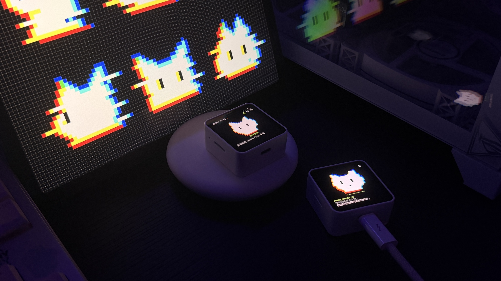
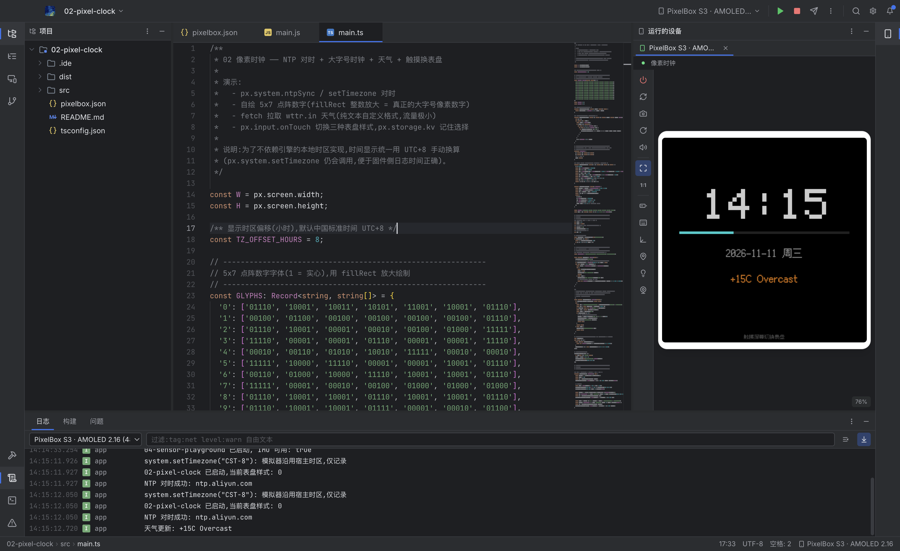
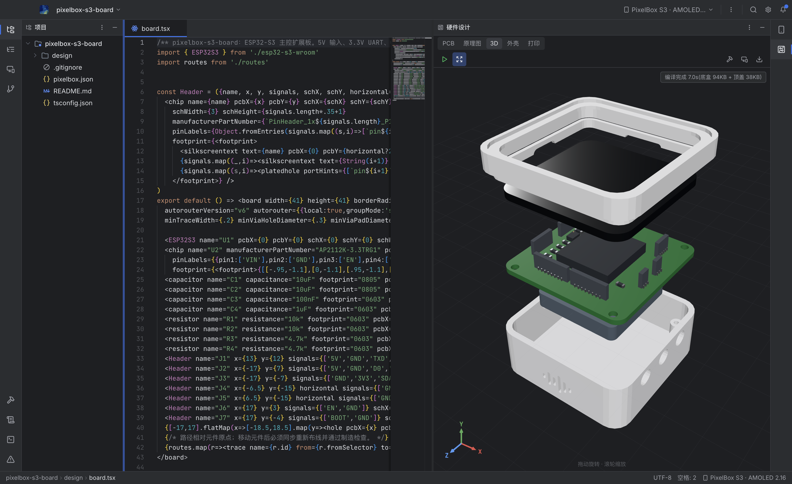
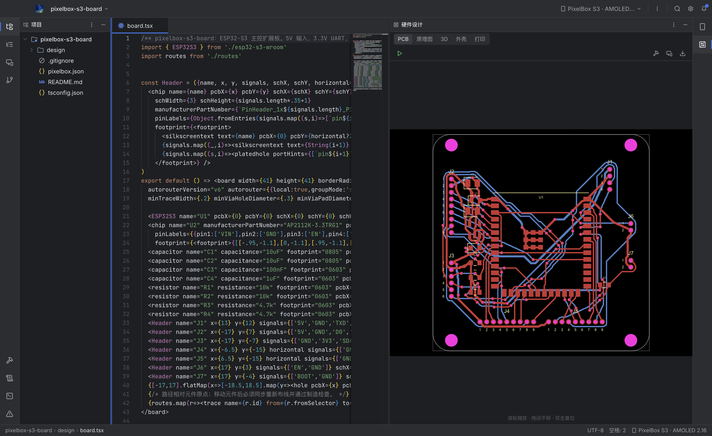
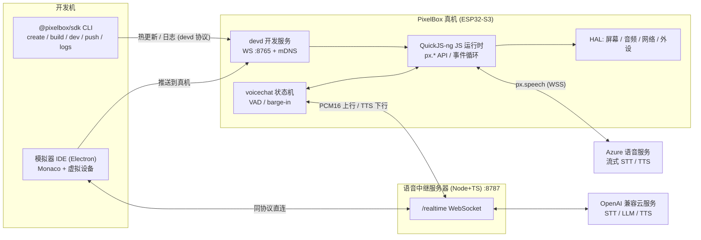

<div align="center">

# PixelBox 像素盒

**一台放在桌上、从屏幕到语音都能用 TypeScript 编程的像素动画小盒子**

面向 ESP32 全系列 · TypeScript 写应用 · 保存即热更新到真机 · 语音大模型对话 · 一体化模拟器 IDE

[](LICENSE)




<sub>真机实拍：两台 PixelBox 正在运行像素小猫应用</sub>

</div>

## 它是什么

PixelBox 在 ESP32 芯片上内嵌了完整的 JavaScript 运行时（QuickJS-ng），把整台设备抽象成一套
TypeScript API `px.*`，覆盖屏幕、触摸、按键、音频、语音、Wi-Fi/BLE、传感器和存储。

写应用的体验接近前端开发：改 TS 代码，保存，一两秒后真机上的画面就更新了。整个过程不用重烧固件，也不用写 C。
手头没有硬件也没关系，模拟器 IDE 实现了和真机相同的 API 与语音协议，可以先在电脑上开发调试。

参考硬件是一台 ESP32-S3 + AMOLED 触摸屏的桌面小盒子，但 PixelBox 并不绑定 S3。模拟器 IDE 与硬件设计工具链
支持 ESP32-S3、C6、P4、C3 和经典 ESP32，PixelBox 固件已适配 S3、C6 和 P4；
同一份应用代码换芯片不用改（见[芯片支持](#芯片支持不止-esp32-s3)）。

## 界面预览

**应用开发**：在 IDE 里打开示例 [`02-pixel-clock`](examples/02-pixel-clock/)，按 ⌃R 在 480×480 虚拟设备上运行。
左边是 TypeScript 源码，右边是虚拟 AMOLED 屏和外设工具条（电源、按键、IMU、GPS、灯带、摄像头），
底部实时显示应用日志。确认无误后，一键推送到真机。



**硬件设计**：电路板用 [tscircuit](https://github.com/tscircuit/tscircuit)（TSX）描述，外壳用 OpenSCAD 编写，
IDE 实时编译出 PCB、原理图和 3D 装配爆炸图。外壳可导出 STL，直接发送到 3D 打印机。
下图是新建 ESP32-S3 硬件工程后自动生成的主控扩展板与外壳。



<details>
<summary>PCB 布线视图</summary>



</details>

## 特性

- **面向 ESP32 全系列**：模拟器、固件工程和硬件模板支持 S3 / C6 / P4 / C3 / 经典 ESP32，PixelBox 固件已适配 S3 / C6 / P4。芯片缺少的能力按契约返回 `ENOTSUP`，应用可以通过 `px.system.info().capabilities` 判断后降级。
- **TypeScript 开发**：[`sdk/types/pixelbox.d.ts`](sdk/types/pixelbox.d.ts) 是完整的 API 类型契约，编辑器里的补全提示就是文档；应用由 esbuild 打包成单文件。
- **秒级热更新**：基于 devd 协议（WebSocket + mDNS 自动发现）推送应用包，设备原子切换后只重启 JS 虚拟机，芯片本身不重启。
- **像素动画引擎**：`onFrame(dt)` 逐帧渲染（1–60 FPS），支持离屏画布、雪碧图、帧动画、GIF 和内置像素字体（含常用中文）；分辨率随板型变化，默认的 2.16 英寸板为 480×480。
- **语音大模型对话**：
  - `px.voice`：设备经自建中继服务器接入任意 OpenAI 兼容的 STT / LLM / TTS，流式回放，支持说话打断（barge-in）。
  - `px.speech`：设备直连 Azure 语音做流式识别与合成，可选 ESP-SR MultiNet7 本地中文唤醒词。
- **完整外设 API**：触摸、按键与手势、IMU 摇一摇与姿态、Wi-Fi / TCP / UDP / mDNS / BLE、NVS 与文件系统、电池电量、OTA；定制板还可选配摄像头、GPS 和灯带。
- **屏上报错**：应用抛出未捕获异常时，设备屏幕会直接显示错误。非致命错误显示为顶部横幅（5 秒后消失），入口崩溃或反复出错则显示全屏错误卡（应用名、摘要、调用栈），模拟器行为一致（见[排错手册 §10.1](docs/troubleshooting.md)）。
- **一体化模拟器 IDE**：Electron + Monaco 构建的 JetBrains 风格桌面 IDE，支持三类工程：
  - **应用工程**：虚拟像素屏加虚拟外设面板，不接硬件也能跑通全部 API，可一键推送到真机。
  - **固件工程**：集成 ESP-IDF / NuttX 构建与烧录，C/C++ 智能提示由 clangd 提供。
  - **硬件工程**：用 tscircuit 设计 PCB、用 OpenSCAD 编写外壳，支持 3D 预览和 STL 导出，并可发送到 OctoPrint、Moonraker 或拓竹打印机。
- **硬件上手门槛低**：Stage A 用微雪现成开发板组装（约 ¥320），Stage B 提供写给新手的定制 PCB 与外壳教程。

## 架构总览



协议细节与一致性规则见 [docs/architecture.md](docs/architecture.md)；API 以
[sdk/types/pixelbox.d.ts](sdk/types/pixelbox.d.ts) 为唯一事实源。

## 芯片支持：不止 ESP32-S3

上层应用只依赖 `px.*` 契约，芯片之间的差异收敛在固件的板型 Kconfig 和 `sdkconfig.defaults.<target>` 里。
芯片没有的能力（如 P4 没有片上 Wi-Fi、C6 没有 PSRAM）会如实降级，不会假装成功。

| 芯片 | 内核 | PixelBox 固件（ESP-IDF） | 模拟器虚拟设备 | IDE 固件工程 | IDE 硬件参考板模板 |
|---|---|---|---|---|---|
| **ESP32-S3**（默认） | 双核 Xtensa LX7 | ✅ 主线，已在微雪 AMOLED 2.16 真机验证 | ✅ | ✅ | PixelBox S3 主控扩展板 |
| **ESP32-C6** | 单核 RISC-V | ✅ 整包编译通过（通用 SPI 屏，无 PSRAM） | ✅ | ✅ | 微雪 ESP32-C6-Touch-AMOLED-2.16 |
| **ESP32-P4** | 双核 RISC-V | ✅ 整包编译通过（无屏调试板，无片上 Wi-Fi/BT） | ✅ | ✅ | 微雪 ESP32-P4-WIFI6-Touch-LCD-4.3 |
| **ESP32-C3** | 单核 RISC-V | 🚧 待适配 | ✅ | ✅ | 微雪 ESP32-C3-LCD-1.47 |
| **ESP32**（经典） | 双核 Xtensa LX6 | 🚧 待适配 | ✅ | ✅ | 微雪 ESP32 One |

- **模拟器虚拟设备**：在设备管理器里按芯片、分辨率、PSRAM 和 Flash 建档，虚拟设备的能力表与对应芯片一致。
- **IDE 固件工程**：新建工程时选择目标芯片，IDE 调用 `idf.py` 完成多芯片构建、合并镜像和烧录。
- **IDE 硬件模板**：新建硬件工程时按芯片生成参考板的 PCB 与外壳，可在此基础上修改。

多芯片的设计原则和 C6 / P4 的移植细节见 [docs/hardware/multi-target.md](docs/hardware/multi-target.md)，适配新芯片或新板子时可以照着做。

## 两套固件实现

仓库包含两套相互独立的固件工程，上层 JS/TypeScript 应用共用同一份 `px.*` 接口契约：

| 实现 | 工程 | 构建入口 | 当前硬件范围 |
| --- | --- | --- | --- |
| ESP-IDF（主线） | `firmware/` | `idf.py build` | ESP32-S3 / C6 / P4 板级支持 |
| Apache NuttX（实验） | `firmware-nuttx/` | `python3 scripts/nuttx.py build --nuttx-path /path/to/nuttx` | ESP32-S3，16 MB Flash + 8 MB Octal PSRAM，Simple Boot |

在模拟器 IDE 里通过「新建项目 → 固件工程」选择实现，在「设置 → 工具 → 固件工具链」分别配置
ESP-IDF 与 NuttX 的路径。选择结果保存在工程的 `pixelbox.json.firmwareBackend` 中，未设置时默认为 ESP-IDF。
生成的 NuttX 工程自带 QuickJS 和共享 FFI prelude，可以脱离本仓库单独构建。

NuttX 版基于 POSIX 和 NuttX 设备接口实现，不依赖 `export.sh`、`idf.py` 或 ESP-IDF bootloader。
接口一致不等于硬件能力已全部移植：网络开发服务、音频、语音等能力的完成度以及未支持时的 `ENOTSUP` 行为，
请查看 [NuttX 固件说明](firmware-nuttx/README.md)，再根据应用需要的能力选择后端。

## 快速开始（三选一）

> 本仓库是 pnpm workspace（sdk / simulator / server / examples）。在仓库根目录执行一次 `pnpm install`
> 即可装齐所有包，根目录的 `pnpm run build`、`pnpm run typecheck`、`pnpm run check` 会逐包执行。
>
> 国内网络首次安装 Electron 二进制时，建议通过环境变量指定镜像（pnpm 不会把 `.npmrc` 里的
> `electron_mirror` 传给安装脚本）：
> `ELECTRON_MIRROR=https://cdn.npmmirror.com/binaries/electron/ pnpm install`

### 路径 1：模拟器体验（无需硬件，约 10 分钟）

```bash
pnpm install                      # 在仓库根目录执行
cd simulator && pnpm run dev
```

打开 `examples/` 下任一示例工程，在编辑器里改代码，虚拟像素屏会实时刷新。

### 路径 2：真机热更新（需要微雪开发板）

```bash
# 固件（需要 ESP-IDF v5.5，详细步骤见 docs/getting-started.md）
tools/fetch_deps.sh
cd firmware && idf.py set-target esp32s3 && idf.py build
idf.py -p <串口> flash monitor

# SDK CLI
pnpm install                                   # 在仓库根目录执行（装过可跳过）
cd sdk && pnpm run build && npm link           # 注册全局命令（也可用 pnpm link --global）
pixelbox create my-app && cd my-app && npm install   # 用户项目可任选 npm 或 pnpm
pixelbox dev        # 监听构建 + 自动推送 + 日志回传
```

### 路径 3：语音对话

```bash
pnpm install           # 在仓库根目录执行（装过可跳过）
cd server
cp .env.example .env   # 填写 OpenAI 兼容 STT / LLM / TTS 的 baseURL、key 和 model
pnpm run dev           # 服务地址 ws://<本机>:8787/realtime
```

在设备端调用 `px.voice.configure({ serverUrl: 'ws://<电脑局域网 IP>:8787/realtime' })`，之后就可以开始对话。

从购板、装环境、烧录、热更新、语音到排错的完整教程见 **[docs/getting-started.md](docs/getting-started.md)**。

## 一个最小应用

```ts
// src/main.ts —— 保存后自动热更新到真机
const { width, height } = px.screen;

px.screen.setFps(30);
px.screen.onFrame(() => {
  px.screen.clear(0x000000);
  const t = performance.now() / 300;
  const y = height / 2 + Math.sin(t) * 60;
  px.screen.fillCircle(width / 2, y | 0, 20, px.color.hsv((t * 40) % 360, 100, 100));
  px.screen.drawText('你好, PixelBox!', 8, 8, { font: 'pixel12', color: px.color.WHITE });
});

px.input.onTouch((ev) => {
  if (ev.type === 'up') px.voice.start(); // 点一下屏幕，开始一轮语音对话
});
```

更多示例（像素时钟、语音助手、IMU 物理小球、拼豆图、桌面伴侣等）见 [examples/](examples/README.md)。

## 硬件路线

| | Stage A：开发板组装 | Stage B：定制 PCB |
|---|---|---|
| 门槛 | 不需要 PCB 知识；选带喇叭的套餐可免焊接 | 立创 EDA 设计 + 嘉立创打样（教程面向新手） |
| 硬件 | 微雪 ESP32-S3-Touch-AMOLED-2.16（默认，1.8 寸版同样支持）+ 喇叭 + 电池 + 3D 打印外壳 | 在 A 的基础上增加 OV2640 摄像头、GPS、WS2812 灯带，外形可定制 |
| 预算（估算） | 约 ¥320 / 台 | 约 ¥1200～2000（含两轮打样） |
| 指南 | [devboard.md](docs/hardware/devboard.md) · [bom.md](docs/hardware/bom.md) | [custom-pcb.md](docs/hardware/custom-pcb.md) · [enclosure.md](docs/hardware/enclosure.md) |

## 仓库导航

| 目录 | 内容 | 入口 |
|---|---|---|
| `docs/` | 架构、产品设计、上手教程、性能分析 | [architecture.md](docs/architecture.md) · [product.md](docs/product.md) · [getting-started.md](docs/getting-started.md) |
| `docs/hardware/` | 开发板组装、定制 PCB、外壳、BOM、多芯片目标 | [devboard.md](docs/hardware/devboard.md) · [custom-pcb.md](docs/hardware/custom-pcb.md) · [enclosure.md](docs/hardware/enclosure.md) · [bom.md](docs/hardware/bom.md) |
| `firmware/` | ESP-IDF v5.5 固件（QuickJS-ng / devd / voicechat / HAL） | [firmware/README.md](firmware/README.md) |
| `firmware-nuttx/` | Apache NuttX 固件（实验性，与 ESP-IDF 版接口一致） | [firmware-nuttx/README.md](firmware-nuttx/README.md) |
| `sdk/` | `@pixelbox/sdk`：d.ts 接口契约 + CLI | [sdk/README.md](sdk/README.md) |
| `simulator/` | Electron 模拟器 IDE | [simulator/README.md](simulator/README.md) |
| `server/` | 语音中继服务器（STT / LLM / TTS 可插拔） | [server/README.md](server/README.md) |
| `examples/` | 示例应用 | [examples/README.md](examples/README.md) |
| `tools/` | 依赖拉取、字体生成、真机诊断等脚本 | — |

## 参与贡献

欢迎提交 Issue 和 Pull Request。修改设备 API 时，请同步更新三处实现，确保真机与模拟器行为一致：

1. 接口契约 `sdk/types/pixelbox.d.ts`（协议层改动同时更新 `docs/architecture.md`）；
2. 固件实现 `firmware/`（以及 `firmware-nuttx/`，未实现的能力返回 `ENOTSUP`）；
3. 模拟器实现 `simulator/`。

提交前请至少在仓库根目录运行 `pnpm run typecheck`；需要完整回归时运行 `pnpm run check`（含全量构建与模拟器自检）。

## 致谢

本项目构建在这些优秀的开源项目之上：
[QuickJS-ng](https://github.com/quickjs-ng/quickjs) ·
[ESP-IDF](https://github.com/espressif/esp-idf) ·
[ESP-SR](https://github.com/espressif/esp-sr) ·
[Apache NuttX](https://nuttx.apache.org/) ·
[LVGL](https://lvgl.io/) ·
[Monaco Editor](https://github.com/microsoft/monaco-editor) ·
[tscircuit](https://github.com/tscircuit/tscircuit) ·
[OpenSCAD](https://openscad.org/)

## 许可证

本项目以 [MIT 许可证](LICENSE) 开源。
第三方组件（QuickJS-ng、ESP-IDF、Apache NuttX 等）遵循各自的开源许可证；
`docs/assets/` 下的图片（渲染图、实拍照片和截图）仅用于本项目的文档展示。
